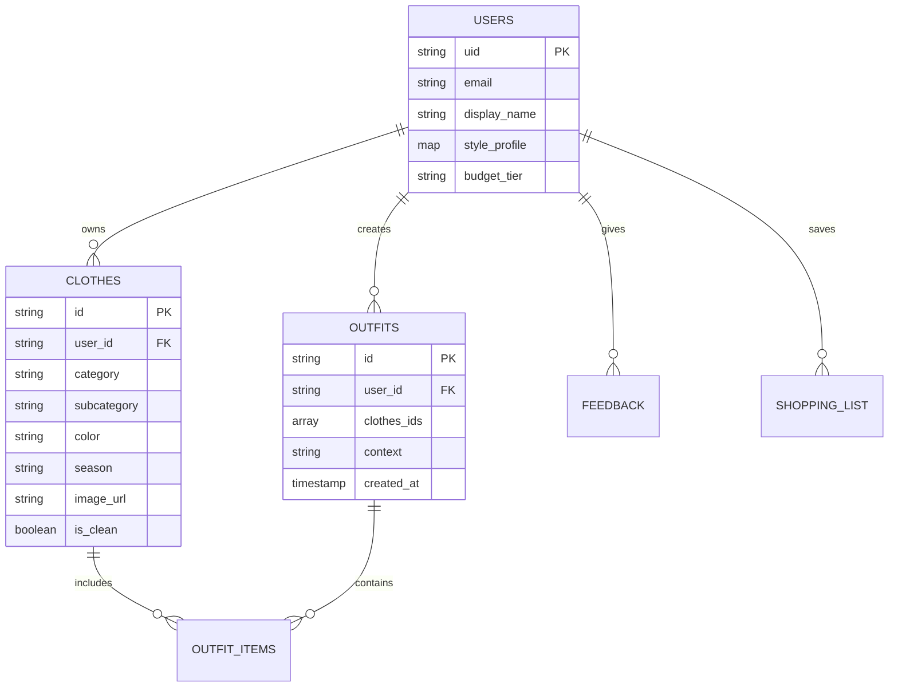

# SmartClothes 👕✨

<div align="center">


**Dolabını Tanıyan, Tarzını Öğrenen Kişiselleştirilmiş Mobil Stil Asistanı**

<p align="center">
  <a href="#-proje-hakkında">Proje Hakkında</a> •
  <a href="#-temel-özellikler">Temel Özellikler</a> •
  <a href="#-sistem-mimarisi-ve-teknoloji">Teknoloji Altyapısı</a> •
  <a href="#-veri-modeli">Veri Modeli</a> •
  <a href="#-yol-haritası">Yol Haritası</a> •
  <a href="#-katkıda-bulunma">Katkıda Bulunma</a>
</p>

</div>

---

## 📖 Proje Hakkında

**SmartClothes**, *"Bugün ne giysem?"* ikilemine son vermek amacıyla geliştirilen yapay zekâ ve kural destekli bir mobil stil asistanıdır. Kullanıcının sahip olduğu gerçek gardırop verilerini, temizlik durumunu, stil profilini ve anlık hava koşullarını harmanlayarak nokta atışı kombinler üretir.

> [!NOTE]
> **Proje Durumu:** 🟡 Erken Aşama / Tasarım & İskelet Oluşturma Süreci. Belirtilen fonksiyonlar ürün gereksinimlerini ve mimari planları temsil eder.

### 💡 Neden SmartClothes?
- **Gerçekçi Öneriler:** İnternetten rastgele kıyafetler değil, **sadece dolabınızdaki temiz parçalarla** oluşturulan kombinler.
- **Dinamik Hava Uyumu:** Konum bazlı gerçek zamanlı hava durumu analizi.
- **Akıllı Eksik Tespiti:** Gardırobunuzu tamamlayacak parçalar için akıllı alışveriş ve marka yönlendirmeleri (*Stil Kutusu*).

---

## ✨ Temel Özellikler

### 1. Kişisel Stil Profili (40 Kombinlik Başlangıç Kataloğu)
- İlk açılışta kullanıcının beğenisine sunulan 40 farklı tarzda referans kombin.
- Kullanıcı en az **5 kombin** seçerek kendi stil DNA'sını oluşturur.
- Zamanla verilen beğeni/beğenmeme geri bildirimleriyle öneri motoru kullanıcının tarzını daha iyi öğrenir.

### 2. Dijital Gardırop Yönetimi
- **Görsel Ekleme:** Kamera veya galeriden fotoğraf yükleme.
- **Detaylı Etiketleme:** Kategori (üst, alt, dış giyim, ayakkabı, aksesuar), renk, kesim, mevsim ve kullanım amacı.
- **Hızlı Arama & Filtreleme:** Dolaptaki tüm parçalara anında erişim.
- **Manuel Kombin Tasarımı:** Kullanıcının kendi tasarladığı favori kombinleri kaydetme.

### 3. Otomatik ve Hassas Hava Durumu
- Konum izniyle anlık sıcaklık ve hava durumu bilgisi otomatik çekilir.
- İzin verilmemesi durumunda manuel şehir/bölge seçimi alternatifi sunulur.
- Kombin motoru hava koşullarına uygun kıyafet katmanlarını (örn. yağmurlu, karlı, rüzgarlı) filtreler.

### 4. Temiz / Kirli Kıyafet Takibi 🧺
- **Durum Yönetimi:** Her kıyafet **Temiz** veya **Kirli** statüsünde tutulur.
- **Akıllı Filtre:** Kirli kıyafetler gardıropta listelenir fakat **otomatik kombin önerilerine dahil edilmez**.
- **Kirli Sepeti:** Çamaşır yıkama sonrasında kıyafetler tek tıkla topluca temiz durumuna geçirilebilir.
- **"Bugün Giydim" Modu:** Gün sonu kombini tek hareketle kirliye taşıma imkanı.

### 5. Kombin Öneri Motoru
Öneri algoritması aşağıdaki çok katmanlı matrisi baz alır:

| Parametre | Açıklama |
| :--- | :--- |
| **Stil Uyumu** | Kullanıcının stil profili ve geçmiş beğenileri |
| **Mevcut Dolap** | Yalnızca kullanıcının fiziksel olarak sahip olduğu parçalar |
| **Temizlik Durumu** | Yalnızca `Temiz` statüsündeki kıyafetler |
| **Hava Koşulları** | Güncel sıcaklık, yağış ve mevsim filtreleri |
| **Renk & Kesim Uyumu** | Kontrast ve tamamlayıcı renk teorisine dayalı eşleşmeler |
| **Etkinlik / Bağlam** | Günlük, iş/ofis, spor, okul, akşam yemeği vb. |

### 6. Stil Kutusu (Eksik Parça & Alışveriş Rehberi) 📬
- Gardırobun eksik kalan anahtar parçalarını (örneğin: *"Kombinlerinizi tamamlayacak temel bir beyaz basic tişört bulunamadı"*) analiz eder.
- **Sıklık:** İlk analizde 5–10 öneri; sonrasında haftada 1–2 anlamlı öneri sunulur.
- **Marka & Bütçe Filtresi:** Ekonomik, F/P veya Premium bütçe segmentine göre uygun mağaza yönlendirmeleri (Zara, Mavi, H&M, Koton vb.).

---

## 📱 Tasarlanan Uygulama Ekranları

```
┌────────────────────────────────────────────────────────┐
│                   SmartClothes UI Flow                 │
├───────────────────┬────────────────────────────────────┤
│ 1. Onboarding     │ Karşılama ve ürün tanıtım akışı    │
│ 2. Stil Seçimi    │ 40 kombinlik onboarding anketi     │
│ 3. Ana Sayfa      │ Hava durumu, günün kombini, bildirim│
│ 4. Dolabım        │ Dijital gardırop ve filtreleme     │
│ 5. Kıyafet Ekle   │ Fotoğraf çekme / detay formu       │
│ 6. Öneri Motoru   │ Otomatik üretilen günün kombinleri │
│ 7. Kirli Sepeti   │ Çamaşır ve temizlik takibi         │
│ 8. Stil Kutusu    │ Eksik parça analizleri ve öneriler │
│ 9. Profil         │ Bütçe, stil ve hesap ayarları      │
└───────────────────┴────────────────────────────────────┘
```

---

## 🛠️ Sistem Mimarisi ve Teknoloji

| Katman | Teknoloji / Kütüphane | Rolü |
| :--- | :--- | :--- |
| **Mobil Framework** | [Flutter](https://flutter.dev) (Dart) | Çapraz platform (iOS & Android) mobil arayüz |
| **Kimlik Doğrulama** | [Firebase Auth](https://firebase.google.com) | E-posta ve sosyal giriş altyapısı |
| **Veritabanı** | [Cloud Firestore](https://firebase.google.com/docs/firestore) | NoSQL gerçek zamanlı veri depolama |
| **Medya Depolama** | [Firebase Storage](https://firebase.google.com/docs/storage) | Kıyafet fotoğraflarının güvenli saklanması |
| **Durum Yönetimi** | [Provider](https://pub.dev/packages/provider) / Riverpod | Uygulama içi durum yönetimi |
| **Konum & Çevre** | [Geolocator](https://pub.dev/packages/geolocator) | Kullanıcı izinli koordinat takibi |
| **Hava Durumu API** | OpenWeatherMap / WeatherAPI | Canlı hava ve tahmin verileri |

---

## 🗃️ Veri Modeli Taslağı



---

## 🗺️ Yol Haritası

- [x] **Aşama 1:** Ürün gereksinim dokümanı ve kapsam belirleme
- [ ] **Aşama 2:** Flutter proje iskeletinin, tema ve temel navigasyonun kurulması
- [ ] **Aşama 3:** Firebase Authentication ve Firestore veri tabanı entegrasyonu
- [ ] **Aşama 4:** 40 kombinlik stil onboarding modülü
- [ ] **Aşama 5:** Dijital gardırop, fotoğraf yükleme ve Temiz/Kirli sepeti
- [ ] **Aşama 6:** Konum servisleri, hava durumu API ve kural tabanlı kombin motoru
- [ ] **Aşama 7:** Stil Kutusu & Akıllı eksik parça öneri modülü
- [ ] **Aşama 8:** UI/UX cila, testler ve MVP sürümü

---

## 🚀 Başlarken (Geliştirici Kurulumu)

Uygulama kodları eklenmeye başladığında projeyi yerel ortamda çalıştırmak için:

### Gereksinimler
- [Flutter SDK](https://docs.flutter.dev/get-started/install) (>= 3.0.0)
- [Dart SDK](https://dart.dev/get-dart)
- Android Studio / VS Code & Flutter Eklentileri

### Kurulum Adımları
```bash
# 1. Repoyu klonlayın
git clone https://github.com/alibarantc/smartclothes.git

# 2. Proje dizinine girin
cd smartclothes

# 3. Bağımlılıkları yükleyin (kod tabanı eklendiğinde)
flutter pub get

# 4. Uygulamayı çalıştırın
flutter run
```

---

## 🤝 Katkıda Bulunma

1. Bu depoyu forklayın (`Fork`).
2. Özellik dalınızı oluşturun (`git checkout -b feature/YeniOzellik`).
3. Değişikliklerinizi commit'leyin (`git commit -m 'feat: Yeni özellik eklendi'`).
4. Dalınıza push yapın (`git push origin feature/YeniOzellik`).
5. Bir **Pull Request** açın.

---

## 📄 Lisans

Bu proje [MIT Lisansı](LICENSE) altında lisanslanmıştır.

<div align="center">
<sub>SmartClothes — Dolabını tanır, tarzını öğrenir. ✨</sub>
</div>
